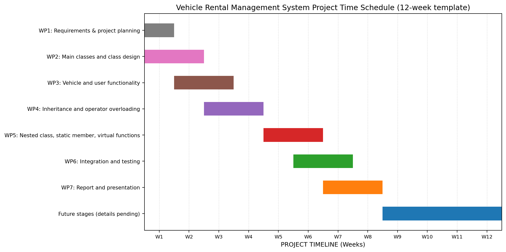

# Vehicle Rental Management System — Project Report

**Course:** Object-Oriented Programming  
**Duration:** 12 Working Weeks  
**Faculty:** Rishabh Gupta  
**Mentor:** Anup Sir

# About Team
**Team Id:** 22  
Team Member:  
**Parth Mhaskar** --------- 20251501184  
**Mayuresh Tuplondhe** - 20251501169  
**Parth Mhaske** ---------- 20251502021  
**Abhishek Patil** --------- 20251502002  
**N Sai Praneeth** -------- 20251502019  

## Why This Project?

Vehicle rental services need to maintain vehicle records, availability, customer details, bookings, and rental bills. Managing these details manually can be slow and may cause mistakes. This project develops a simple Vehicle Rental Management System in C++ using object-oriented programming concepts to organize vehicle and user-related operations.

## Goals of the Project

- Maintain vehicle details such as vehicle ID, name, price per day, and availability.
- Allow renters to add and remove vehicles and view the vehicle list.
- Allow customers to view vehicles, book vehicles, view bookings, return vehicles, and calculate rental bills.
- Calculate rental bills with or without a discount.
- Provide an admin panel to view vehicles, availability, bookings, renters, and customers.
- Apply OOP concepts that are actually implemented in the current source code.

## Work Plan (Stages with OOP Concepts)

### Stage 1: Design and Main Classes

**What we do:** Prepare the use-case diagram, sequence diagram, and class diagram, and create the main classes.

**OOP idea — Encapsulation:** The `Vehicle` class keeps its data members private and provides methods to access or update vehicle information. The `database` class keeps `vehicleList` private and provides operations to manage vehicles.

**Goal:** Establish the main classes and basic vehicle-management and user-role functionality.

### Stage 2: Extending the Class Design

**What we do:** Add inheritance and class features needed by the system.

- **Inheritance:** `renter`, `customer`, and `admin` are derived from the `user` base class and reuse common user details.
- **Access specifiers and constructors:** `private`, `protected`, and `public` members control access; constructors initialize `Vehicle` and user-role objects.
- **Operator overloading:** The stream insertion operator `<<` is overloaded as a friend function to display `Vehicle` details.
- **Method overloading:** Billing functions support a normal bill and a discounted bill.

**Goal:** Connect the role classes and support object initialization, vehicle display, and billing.

### Stage 3: Further OOP Features and Integration

**What we do:** Add further OOP features and integrate the renter, customer, and admin operations.

- **Stream operator overloading using a friend function:** The overloaded `<<` function accesses `Vehicle` details and formats them for output.
- **Nested class:** `database` contains the nested `Discount` class, which applies a discount to the rental bill.
- **Static variable:** `database::vehicleCount` stores a vehicle count shared by database objects.
- **Virtual function and abstraction:** `user` declares `displayUser()` as a pure virtual function, and `renter`, `customer`, and `admin` provide role-specific implementations. This makes `user` an abstract class.
- **`final` keyword:** `admin` is declared `final`, so it cannot be used as a base class; its `displayUser()` override is also `final`.

**Note:** Object slicing, static functions, the `this` pointer, virtual base classes, and standalone pointers to objects or derived classes are not described as implemented concepts because they are not demonstrated in the supplied source code.

**Goal:** Integrate the user-role menus, vehicle operations, and bill calculation into one menu-driven program.

## Work Packages and Milestones

- **WP1:** Plan requirements and identify vehicle data and user roles.
- **WP2:** Create the main classes and establish the class structure.
- **WP3:** Implement vehicle listing, availability, booking, returning, and billing.
- **WP4:** Add inheritance, access control, constructors, friend output, and overloaded billing methods.
- **WP5:** Add the nested `Discount` class, static vehicle counter, and virtual display functions.
- **WP6:** Integrate the renter, customer, and admin menus and test the main flow.
- **WP7:** Prepare the project report and presentation.

The sample uses a 12-week timeline. Exact dates for this project were not provided, so the timeline uses week numbers. Weeks 9–12 are reserved for future stages that will be defined later.

## Final Outcomes

- A menu-driven C++ Vehicle Rental Management System with renter, customer, and admin roles.
- Vehicle listing, availability checking, booking, returning, and booking-list functionality.
- Rental bill calculation with and without a discount.
- Implemented OOP features including encapsulation, inheritance, access specifiers, constructors, friend functions, operator and method overloading, a nested class, a static data member, an abstract class, virtual functions, and `final`.

## Project Time Schedule (12-Week Template)

*Figure 1: Vehicle Rental Management System timeline (week-based planning template).*
